<div align="center">

</div>

<h2 align="center">About Me</h2>

I'm an Informatics student who enjoys designing and building software, especially on the backend side. I like working with APIs, organizing data, understanding application architecture, and turning requirements into useful software.

- 🚀 **Learning now:** CI/CD with GitHub Actions, and Python for numerical methods & statistics
- 🎯 **Focus:** Software Engineering & Backend Development: REST API, database design, and web applications
- 🛠️ **Stack:** JavaScript, Node.js, PHP, MySQL
- 🧠 **Mindset:** Learn continuously. Build consistently. Improve deliberately.
- 💬 **Any questions?** Feel free to reach out!

<details>
<summary><b>▶ run <code>node fariid.js</code></b></summary>

```text
$ node fariid.js
> Learn continuously.
> Build consistently.
> Improve deliberately.
> isCoffeeNeeded → true ☕
```

</details>

<h2 align="center">Languages and activity</h2>

<div align="center">


<br/>

</div>

<h2 align="center">Featured Projects</h2>

<div align="center">
<a href="https://github.com/farridfaqih-beep/booking-management-api"></a>
<a href="https://github.com/farridfaqih-beep/Lensa-Studio"></a>
<br/>
<a href="https://github.com/farridfaqih-beep/Metode-Numerik"></a>
<a href="https://github.com/farridfaqih-beep/Statistika"></a>
<br/>
<a href="https://github.com/farridfaqih-beep/Project-RPL"></a>
<a href="https://github.com/fluttersha-hub/UAS-DASPRO-KELOMPOK-1"></a>
</div>

<h2 align="center">Tech Stack</h2>

<div align="center">

</div>

<h2 align="center">Contacts</h2>

<div align="center">
<a href="https://github.com/farridfaqih-beep"></a>
<a href="https://instagram.com/fariidfaqih_"></a>
<a href="mailto:farridfaqih@gmail.com"></a>

<br/><br/>


<br/><br/>


</div>
