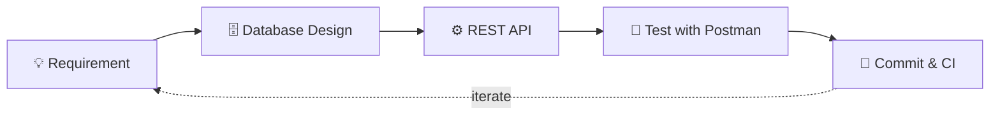

<div align="center">


<br/>

<a href="https://github.com/farridfaqih-beep"></a>
<a href="https://instagram.com/fariidfaqih_"></a>
<a href="mailto:farridfaqih@gmail.com"></a>


<br/><br/>

<sub>
<a href="#01--about-me"><b>About</b></a> &nbsp;·&nbsp;
<a href="#02--tech-stack"><b>Stack</b></a> &nbsp;·&nbsp;
<a href="#03--featured-projects"><b>Projects</b></a> &nbsp;·&nbsp;
<a href="#04--how-i-build"><b>Workflow</b></a> &nbsp;·&nbsp;
<a href="#05--progress-log"><b>Progress</b></a> &nbsp;·&nbsp;
<a href="#06--github-stats"><b>Stats</b></a> &nbsp;·&nbsp;
<a href="#07--lets-connect"><b>Connect</b></a>
</sub>



</div>

## `01` / About Me

```text
fariid@github:~$ neofetch

   ┌───────────────┐     fariid@farridfaqih-beep
   │   { }   />    │     ─────────────────────────────────
   │   ▓▓▓▓▓▓▓▓    │     Role      Informatics Student
   │   ▒▒▒▒▒▒▒▒    │     Focus     Backend & REST API
   │   ░░░░░░░░    │     Stack     JS · Node.js · PHP · MySQL
   └───────────────┘     Editor    VS Code
                         Status    Building · Learning · Shipping
```

```js
const fariid = {
  name: "Muhammad Fariid Faqih",
  role: "Informatics Student",
  location: "Indonesia 🇮🇩",
  interests: ["Software Engineering", "Backend Development"],
  focus: ["REST API", "Database Design", "Web Application Development"],
  stack: ["JavaScript", "Node.js", "PHP", "MySQL"],
  currentlyLearning: ["CI/CD with GitHub Actions", "Python for Numerical Methods & Statistics"],
  mindset: "Learn continuously. Build consistently. Improve deliberately.",
  isCoffeeNeeded: true,
};
```

I'm an Informatics student who enjoys designing and building software, especially on the backend side. I like working with APIs, organizing data, understanding application architecture, and turning requirements into useful software.

> 🎯 **Current direction:** Software Engineering & Backend Development, while strengthening my programming fundamentals through hands-on projects.

<div align="center"></div>

## `02` / Tech Stack

<div align="center">

</div>

<div align="center"></div>

## `03` / Featured Projects

<div align="center">
<a href="https://github.com/farridfaqih-beep/booking-management-api"></a>
<a href="https://github.com/farridfaqih-beep/Lensa-Studio"></a>
</div>

### 🗂️ More from my workspace

| Project | Stack | What it's about |
| :-- | :-- | :-- |
| [**Metode-Numerik**](https://github.com/farridfaqih-beep/Metode-Numerik) |  | Numerical methods implemented in Python |
| [**Statistika**](https://github.com/farridfaqih-beep/Statistika) |  | Statistics practice & data analysis notebooks |
| [**Project-RPL**](https://github.com/farridfaqih-beep/Project-RPL) |  | Software engineering coursework with CI practice |
| [**UAS-DASPRO-KELOMPOK-1**](https://github.com/fluttersha-hub/UAS-DASPRO-KELOMPOK-1) |  | Team project for the Programming Fundamentals final exam |

<div align="center"></div>

## `04` / How I Build



<sub>From requirement to working software: understand the problem, model the data, build the endpoints, test them, then ship and improve.</sub>

<div align="center"></div>

## `05` / Progress Log

- [x] 🚀 Build a REST API with Node.js — *booking-management-api*
- [x] 📸 Build a full web app with PHP & MySQL — *Lensa Studio*
- [x] ⚙️ Practice CI with GitHub Actions — *Project-RPL*
- [x] 🤝 Collaborate on a team project — *UAS-DASPRO-KELOMPOK-1*
- [ ] 🔐 Add authentication (JWT) to an API
- [ ] 🐳 Learn Docker & deployment
- [ ] 🧪 Write automated tests for backend projects

<div align="center"></div>

## `06` / GitHub Stats

<div align="center">


<br/>


<br/>


<!--
  Snake animation: aktifkan setelah workflow snake.yml berhasil dijalankan
  (hapus tanda komentar di bawah ini).


-->

<sub>Statistik dibuat dari aktivitas publik GitHub. Kartu eksternal dapat memerlukan waktu untuk diperbarui atau sesekali tidak tersedia.</sub>

</div>

<div align="center"></div>

## `07` / Let's Connect

<div align="center">

<sub>💬 Happy to chat about REST API design, database design, and web application development.</sub>

<br/><br/>

<a href="https://github.com/farridfaqih-beep"></a>
<a href="https://instagram.com/fariidfaqih_"></a>
<a href="mailto:farridfaqih@gmail.com"></a>

<br/><br/>


</div>
