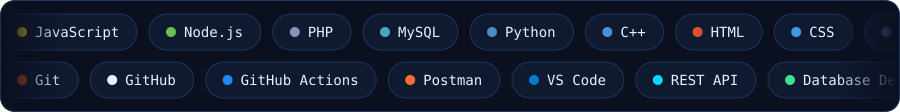
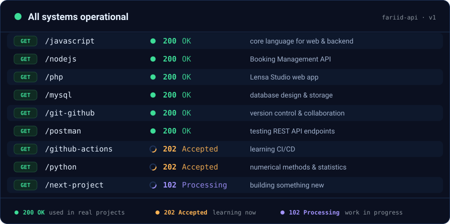

<div align="center">



<br/>

<a href="https://github.com/farridfaqih-beep"></a>
<a href="https://instagram.com/fariidfaqih_"></a>
<a href="mailto:farridfaqih@gmail.com"></a>

<br/>


<br/><br/>

<sub>
<a href="#01--about-me"><b>About</b></a> &nbsp;·&nbsp;
<a href="#02--tech-stack"><b>Stack</b></a> &nbsp;·&nbsp;
<a href="#03--featured-projects"><b>Projects</b></a> &nbsp;·&nbsp;
<a href="#04--how-i-build"><b>Workflow</b></a> &nbsp;·&nbsp;
<a href="#05--status-board"><b>Status</b></a> &nbsp;·&nbsp;
<a href="#06--github-stats"><b>Stats</b></a> &nbsp;·&nbsp;
<a href="#07--lets-connect"><b>Connect</b></a>
</sub>


</div>

## `01` / About Me

<div align="center">

</div>

<br/>

I'm an Informatics student who enjoys designing and building software, especially on the backend side. I like working with APIs, organizing data, understanding application architecture, and turning requirements into useful software.

> 🎯 **Current direction:** Software Engineering & Backend Development, while strengthening my programming fundamentals through hands-on projects.

<details>
<summary><b>▶ run <code>node fariid.js</code></b></summary>

```text
$ node fariid.js
> Learn continuously.
> Build consistently.
> Improve deliberately.
> isCoffeeNeeded → true ☕
```

</details>

<div align="center"></div>

## `02` / Tech Stack

<div align="center">

</div>

<div align="center"></div>

## `03` / Featured Projects

<div align="center">
<a href="https://github.com/farridfaqih-beep/booking-management-api"></a>
<a href="https://github.com/farridfaqih-beep/Lensa-Studio"></a>
</div>

### 🗂️ More from my workspace

<div align="center">
<a href="https://github.com/farridfaqih-beep/Metode-Numerik"></a>
<a href="https://github.com/farridfaqih-beep/Statistika"></a>
<br/>
<a href="https://github.com/farridfaqih-beep/Project-RPL"></a>
<a href="https://github.com/fluttersha-hub/UAS-DASPRO-KELOMPOK-1"></a>
</div>

<div align="center"></div>

## `04` / How I Build

<div align="center">

</div>

<sub>From requirement to working software: understand the problem, model the data, build the endpoints, test them, then ship and improve.</sub>

<div align="center"></div>

## `05` / Status Board

<div align="center">

</div>

<div align="center"></div>

## `06` / GitHub Stats

<div align="center">


<br/>


<br/>


<!--
  Snake animation: aktifkan setelah workflow snake.yml berhasil dijalankan
  (hapus tanda komentar di bawah ini).


-->

<sub>Statistik dibuat dari aktivitas publik GitHub. Kartu eksternal dapat memerlukan waktu untuk diperbarui atau sesekali tidak tersedia.</sub>

</div>

<div align="center"></div>

## `07` / Let's Connect

<div align="center">



<br/>

<a href="https://github.com/farridfaqih-beep"></a>
<a href="https://instagram.com/fariidfaqih_"></a>
<a href="mailto:farridfaqih@gmail.com"></a>

<br/><br/>



</div>
